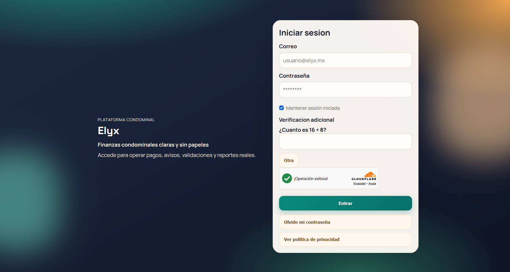
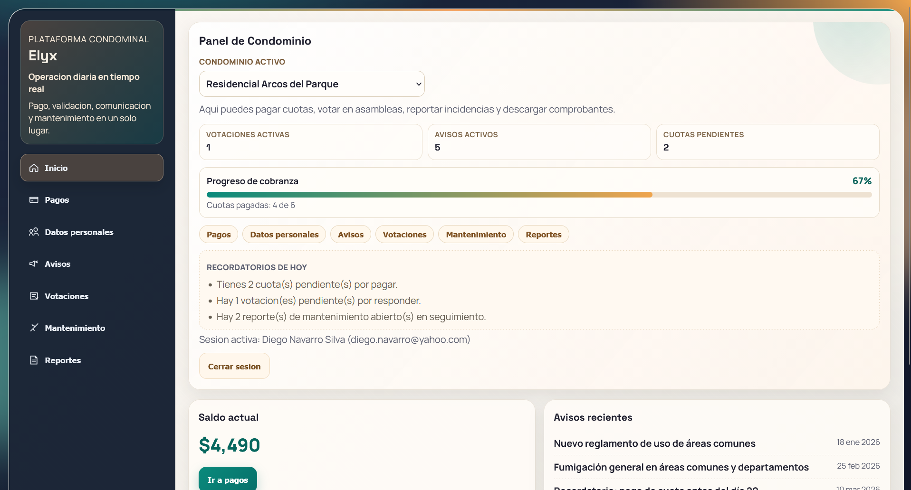
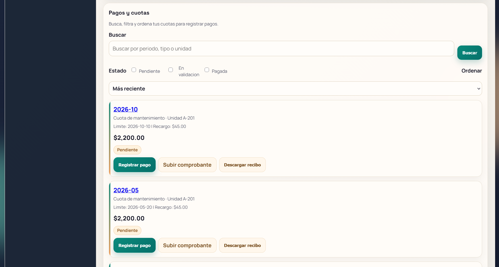
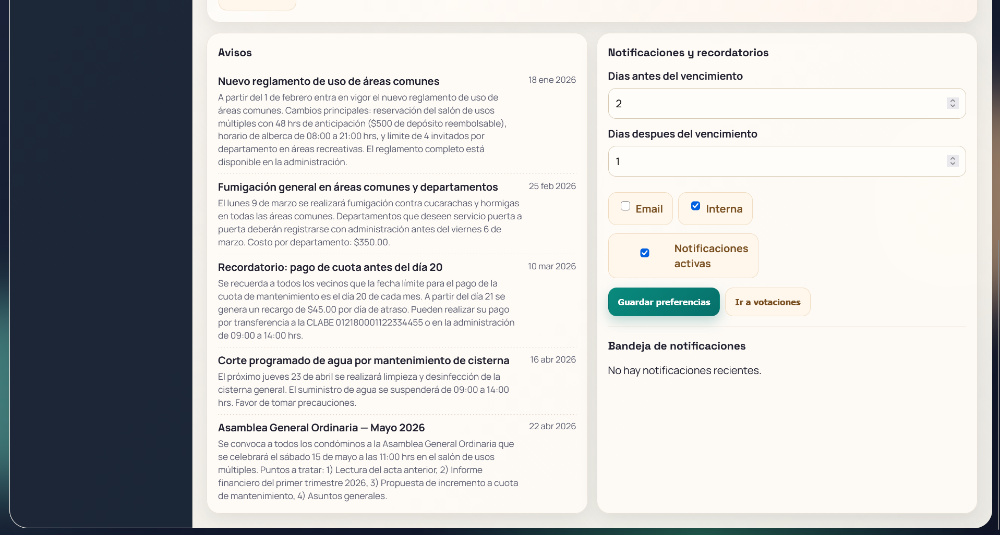
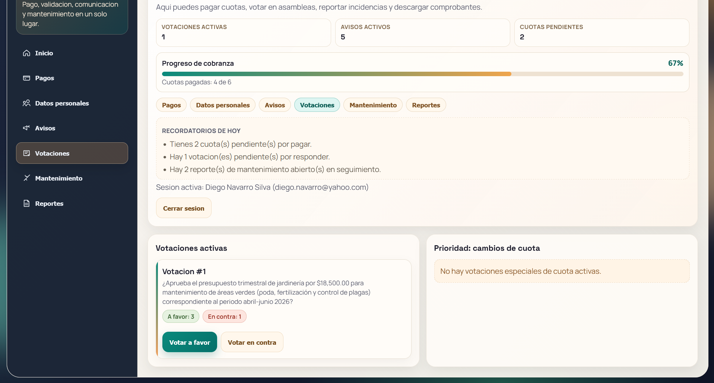
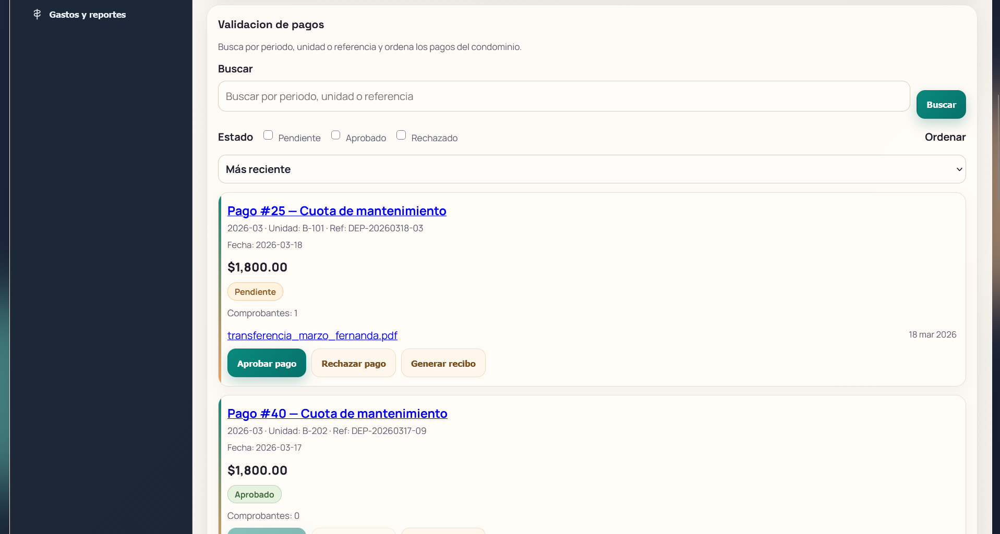
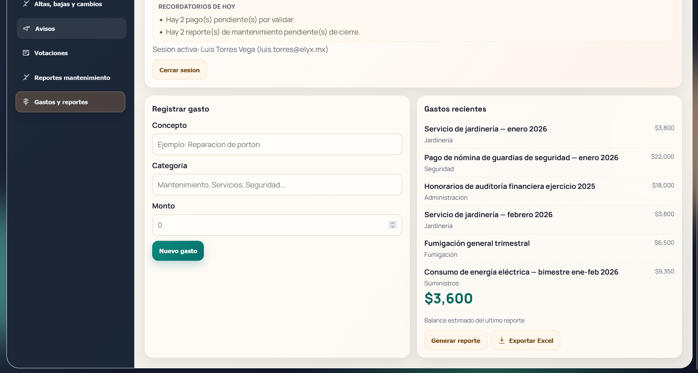
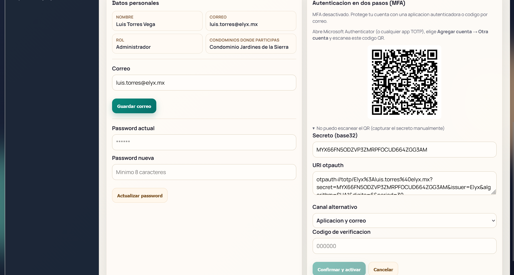

<div align="center">

# Elyx

**Administración de condominios sin papeles: cuotas, pagos, avisos, votaciones y finanzas en un solo lugar.**

[](https://react.dev)
[](https://nestjs.com)
[](https://www.postgresql.org)
[](https://www.typescriptlang.org)
[](https://docs.docker.com/compose/)

[Usar Elyx](#usar-elyx) · [Funcionalidades](#funcionalidades) · [Seguridad](#seguridad) · [Instalación](#instalación) · [API](#api)

</div>

---

## Contenido

- [Capturas](#capturas)
- [¿Qué es Elyx?](#qué-es-elyx)
- [Funcionalidades](#funcionalidades)
- [Seguridad](#seguridad)
- [Stack técnico](#stack-técnico)
- [Usar Elyx](#usar-elyx)
- [Instalación](#instalación)
- [Configuración](#configuración)
- [API](#api)
- [Estructura del repositorio](#estructura-del-repositorio)
- [Preguntas frecuentes](#preguntas-frecuentes)

---

## Capturas

| Inicio de sesión | Panel del condómino |
|:---:|:---:|
|  |  |

| Pagos y cuotas | Avisos |
|:---:|:---:|
|  |  |

| Votaciones | Validación de pagos (administrador) |
|:---:|:---:|
|  |  |

| Gastos y reportes financieros | Autenticación en dos pasos |
|:---:|:---:|
|  |  |

---

## ¿Qué es Elyx?

Elyx es una plataforma web para administrar un condominio de principio a fin. Sustituye
las hojas de cálculo, los grupos de mensajería y los recibos en papel por un sistema
donde cada parte ve exactamente lo que le corresponde:

- El **condómino** consulta su estado de cuenta, registra pagos, sube comprobantes,
  descarga recibos, responde votaciones y reporta fallas.
- El **administrador** valida pagos, emite cuotas, publica avisos, convoca votaciones
  —incluido el cambio de la cuota de mantenimiento— y lleva el control de gastos y
  reportes financieros.
- El **superusuario** da de alta condominios completos con sus unidades y su primer
  administrador.

Todo el dinero que se mueve en el condominio queda trazado: cada pago tiene su
comprobante, su validación, su recibo y su línea en el reporte financiero del periodo.

---

## Funcionalidades

### Para el condómino

| Módulo | Qué resuelve |
|---|---|
| **Estado de cuenta** | Saldo actual, adeudo total, recargos estimados y fecha de corte por unidad |
| **Pagos y cuotas** | Buscar, filtrar y ordenar sus cuotas; registrar pago, subir comprobante y descargar recibo |
| **Avisos** | Comunicados del administrador con fecha de publicación |
| **Votaciones** | Votar asambleas abiertas y consultar resultados |
| **Mantenimiento** | Reportar fallas con descripción y fotografías, y seguir el estatus |
| **Reportes** | Consultar el histórico de cuotas y pagos de su unidad |

### Para el administrador

| Módulo | Qué resuelve |
|---|---|
| **Validación de pagos** | Buscar por periodo, unidad o referencia; aprobar, rechazar (con motivo) y generar recibos |
| **Cuotas** | Emisión por periodo, monto, recargo por día y fecha límite por unidad |
| **Avisos** | Publicación de comunicados al condominio |
| **Votaciones** | Convocar votaciones generales y ejecutar acuerdos de cambio de cuota aprobados |
| **Reportes de mantenimiento** | Dar seguimiento a los reportes de los condóminos con comentarios y evidencias |
| **Gastos** | Registro de gastos por categoría, proveedor y comprobante |
| **Reportes financieros** | Ingresos, egresos y adeudos por periodo, con exportación a **PDF** y **Excel** |
| **Altas, bajas y cambios** | Administrar unidades, ocupantes y membresías del condominio |

### Para el superusuario

| Módulo | Qué resuelve |
|---|---|
| **Alta de condominios** | Crear el condominio, sus unidades y el primer administrador en un solo flujo |
| **Administración multi-condominio** | Consultar y operar los condominios de la plataforma |

### Transversal

- **Actualizaciones en tiempo real** por WebSocket: cuando cambia un pago o una cuota,
  la vista se refresca sin recargar la página.
- **Multi-condominio**: un usuario con membresías en varios condominios alterna entre
  ellos sin cerrar sesión.
- **Listados paginados** con búsqueda, filtro por estado y orden, con el estado en la
  URL para poder compartir o recuperar una vista exacta.
- **Diseño responsivo** para usarse desde escritorio, tableta o teléfono.

---

## Seguridad

Elyx se diseñó asumiendo que la sesión, el dinero y los datos personales son el activo a
proteger. Estas son las medidas implementadas, no intenciones:

| Medida | Implementación |
|---|---|
| **Access token corto** | JWT con `ACCESS_TOKEN_TTL=15m` |
| **Refresh token rotatorio** | Cookie `HttpOnly` + `SameSite=Strict`, acotada a `/api/auth`. Cada uso lo rota; el reuso de un token ya rotado revoca **toda la familia** |
| **"Mantener sesión iniciada"** | Opcional. Marcado: cookie persistente de 7 días. Sin marcar: cookie de sesión (sin `expires`) y token de 12 h; al cerrar el navegador hay que volver a entrar |
| **CSRF** | Doble envío: cookie `elyx_csrf` + cabecera `X-CSRF-Token`, validada por un guard global en todos los métodos mutantes |
| **Autorización por condominio** | Cada petición se contrasta contra las membresías del token; un condómino no puede leer otro condominio |
| **Segundo CAPTCHA propio** | Operación matemática de un solo uso, obligatoria tras 3 fallos de login y siempre en la recuperación de contraseña |
| **Turnstile** | Cloudflare Turnstile en el inicio de sesión y la recuperación de contraseña (`TURNSTILE_ENABLED`) |
| **MFA** | TOTP compatible con Microsoft Authenticator o Google Authenticator (código QR + códigos de recuperación), con OTP de 6 dígitos por correo como alternativa |
| **Bloqueo progresivo** | Tras varios intentos fallidos la cuenta se bloquea de forma escalonada (5 → 15 → 30 → 60 minutos) |
| **Límite de peticiones** | `@nestjs/throttler` con almacenamiento en Redis |
| **Contraseñas** | Hash bcrypt; nunca se almacenan ni se registran en claro |
| **Secretos** | El secreto TOTP se guarda cifrado con AES-256-GCM (`MFA_ENCRYPTION_KEY`) |
| **Auditoría** | Cada intento de login (exitoso o no) y cada evento de comportamiento se registran en base de datos |
| **Telemetría de comportamiento** | Eventos agregados (sin valores de formulario) que puntúan la sesión; en modo `strict` se rechazan sesiones automatizadas |
| **Robots** | `robots.txt` declara privadas `/api/`, `/uploads/` y `/perfil`, con `Crawl-delay: 2` |

---

## Stack técnico

| Capa | Tecnología |
|---|---|
| **Frontend** | React 18, Vite 5, TypeScript 5, React Router 6, socket.io-client, pdf-lib, xlsx |
| **Backend** | NestJS 10, TypeScript 5, TypeORM (SQL explícito), `jsonwebtoken`, `bcrypt`, `qrcode`, `@nestjs/throttler` |
| **Base de datos** | PostgreSQL 16 |
| **Caché y colas ligeras** | Redis 7 (throttler, retos de CAPTCHA/MFA, bloqueo de cuentas) |
| **Correo** | SMTP o Resend (`RESEND_API_KEY`) |
| **Orquestación** | Docker Compose |

---

## Usar Elyx

Hay dos caminos. Ambos usan exactamente el mismo código.

### A) Usar Elyx alojado — [elyx-app.com](https://elyx-app.com)

Si no quieres administrar servidores, bases de datos ni respaldos, te damos de alta tu
condominio en la instancia oficial y te entregamos los accesos de administrador listos
para usar.

**Cómo empezar:** escríbenos con el nombre de tu condominio, su dirección y el número de
unidades. Nosotros hacemos el registro y te enviamos las credenciales del administrador.

**Tarifa mensual** (pesos mexicanos, MXN):

| Unidades | Tarifa mensual |
|---:|:---:|
| 30 | **$450** |
| 40 | **$480** |
| 50 | **$500** |

¿Tu condominio tiene otro tamaño? Escríbenos y te preparamos una cotización a la medida.

**Contacto:** [contacto@elyx-app.com](mailto:contacto@elyx-app.com)

<!--
  TODO: sustituye contacto@elyx-app.com por tu correo real y, si quieres,
  añade aquí tu teléfono o un enlace de WhatsApp.
-->

> ¿Prefieres verlo antes de decidir? La instancia oficial está en
> **https://elyx-app.com** — podemos crear un condominio de demostración con datos de
> ejemplo para que lo recorras con calma.

### B) Autoalojarlo tú

Elyx es autocontenido: un `docker compose up` levanta base de datos, caché, API y
aplicación web. Si tienes un servidor con Docker, en unos minutos tienes tu propia
instancia.

- **En tu computadora:** http://localhost:5173
- **En tu servidor:** el dominio que apuntes (por ejemplo, `https://elyx.midominio.com`)

Sigue la sección de [Instalación](#instalación).

---

## Instalación

### Requisitos

- Docker Engine 24+ con el plugin `docker compose` (v2)
- 2 GB de RAM y 5 GB de disco libres como mínimo

### Local

```bash
# 1. Variables de entorno
cp .env.example .env

# 2. Levantar el stack (la primera vez compila las imágenes)
docker compose up --build
```

Servicios:

| Servicio | URL |
|---|---|
| Aplicación web | http://localhost:5173 |
| API | http://localhost:3000/api |
| Estado del backend | http://localhost:3000/api/health |

La base de datos se inicializa sola con el esquema y datos de ejemplo la primera vez que
arranca el volumen (`infra/postgres/init`).

### Actualizar una instancia existente

```bash
git fetch --all
git pull --ff-only

docker compose up -d --force-recreate --build backend frontend
```

Si el `pull` trajo cambios en el esquema, aplica la migración correspondiente de
`apps/backend/src/database/migrations/` antes de reiniciar.

### Producción

1. Copia tu configuración de producción en `.env` y ajusta como mínimo:

   ```env
   NODE_ENV=production
   COOKIE_SECURE=true
   AUTH_REQUIRED=true
   FRONTEND_URL=https://tu-dominio.com
   PUBLIC_FILES_BASE_URL=https://api.tu-dominio.com
   CORS_ALLOWED_ORIGINS=https://tu-dominio.com,https://www.tu-dominio.com
   JWT_SECRET=<cadena aleatoria larga>
   CSRF_SECRET=<cadena aleatoria larga>
   MFA_ENCRYPTION_KEY=<cadena aleatoria larga>
   ```

2. Publica la API y la web detrás de un proxy inverso con TLS (nginx, Caddy, Traefik) y
   no expongas los puertos de los contenedores a internet.
3. Programa respaldos del volumen de PostgreSQL (`postgres_data`) y del directorio de
   archivos subidos (`apps/backend/uploads`).

> Con `COOKIE_SECURE=true` el navegador exige HTTPS: sin TLS el inicio de sesión no
> funcionará. Es intencional.

---

## Configuración

Todas las variables viven en `.env`. Las más relevantes:

### Base de datos y red

| Variable | Por defecto | Para qué |
|---|---|---|
| `POSTGRES_DB` / `POSTGRES_USER` / `POSTGRES_PASSWORD` | `elyx` / `elyx_user` / `elyx_pass` | Credenciales de PostgreSQL |
| `DATABASE_URL` | `postgres://…@postgres:5432/elyx` | Cadena de conexión |
| `REDIS_URL` | `redis://redis:6379` | Caché y límites |
| `BACKEND_PORT` / `FRONTEND_PORT` | `3000` / `5173` | Puertos publicados |
| `FRONTEND_URL` | `http://localhost:5173` | Origen permitido y enlaces en correos |
| `CORS_ALLOWED_ORIGINS` | vacío | Lista separada por comas; se añade sola la variante con/sin `www.` |
| `PUBLIC_FILES_BASE_URL` | `http://localhost:3000` | Base para las URLs de comprobantes y evidencias |

### Sesiones y seguridad

| Variable | Por defecto | Para qué |
|---|---|---|
| `AUTH_REQUIRED` | `true` | Exige token Bearer en los endpoints protegidos |
| `ACCESS_TOKEN_TTL` | `15m` | Vida del access token |
| `REFRESH_TOKEN_TTL_DAYS` | `7` | Vida del refresh cuando se marca "mantener sesión iniciada" |
| `REFRESH_TOKEN_TTL_SESSION_HOURS` | `12` | Vida del refresh cuando **no** se marca |
| `COOKIE_SECURE` | `false` | `true` en producción (requiere HTTPS) |
| `JWT_SECRET` | — | Firma de los JWT |
| `CSRF_SECRET` | — | Firma de los tokens CSRF |
| `MFA_ENCRYPTION_KEY` | — | Cifrado AES-256-GCM del secreto TOTP |
| `CAPTCHA_MATH_ENABLED` | `true` | Activa el segundo CAPTCHA propio |
| `CAPTCHA_MATH_ENFORCE` | `after_failures` | `always` para exigirlo siempre |
| `BEHAVIOR_ENFORCE` | `soft` | `soft` solo mide; `strict` rechaza sesiones automatizadas |
| `TURNSTILE_ENABLED` / `TURNSTILE_SECRET_KEY` | `false` / — | Cloudflare Turnstile |

### Correo

| Variable | Para qué |
|---|---|
| `SMTP_HOST`, `SMTP_PORT`, `SMTP_USER`, `SMTP_PASS`, `SMTP_FROM` | Envío por SMTP (recuperación de contraseña, OTP) |
| `RESEND_API_KEY` | Alternativa a SMTP vía Resend |

> Sin correo configurado, los mensajes se escriben en el log del backend: útil en
> desarrollo, insuficiente en producción.

---

## API

API REST bajo `/api`. Todos los endpoints de negocio exigen `Authorization: Bearer <token>`
y validan la pertenencia al condominio solicitado.

### Autenticación

| Método | Ruta | Descripción |
|---|---|---|
| `GET` | `/api/auth/csrf` | Devuelve el token CSRF vigente (solo emite uno nuevo si la cookie falta o no es válida) |
| `POST` | `/api/auth/login` | Inicia sesión; responde `202` si hace falta segundo factor |
| `POST` | `/api/auth/refresh` | Rota el refresh token y entrega un access token nuevo |
| `POST` | `/api/auth/logout` | Revoca la sesión persistente |
| `POST` | `/api/auth/forgot-password` | Solicita el restablecimiento de contraseña |
| `POST` | `/api/auth/validate-reset-token` | Comprueba que el enlace de restablecimiento sigue vigente |
| `POST` | `/api/auth/reset-password` | Define la nueva contraseña con el token recibido |
| `PATCH` | `/api/auth/perfil` | Actualiza los datos personales |
| `PATCH` | `/api/auth/password` | Cambio de contraseña estando autenticado |
| `GET` | `/api/captcha/challenge` | Reto matemático de un solo uso |

### Segundo factor (MFA)

| Método | Ruta | Descripción |
|---|---|---|
| `POST` | `/api/auth/mfa/setup` | Genera el secreto TOTP y el código QR |
| `POST` | `/api/auth/mfa/enable` | Activa MFA verificando el primer código |
| `POST` | `/api/auth/mfa/verify` | Verifica el código del desafío de login |
| `POST` | `/api/auth/mfa/resend` | Reenvía el OTP por correo |
| `GET` | `/api/auth/mfa/estado` | Estado de MFA del usuario |
| `POST` | `/api/auth/mfa/disable` | Desactiva MFA |

### Cuotas y pagos

| Método | Ruta | Descripción |
|---|---|---|
| `GET` | `/api/cuotas` | Cuotas del condominio |
| `GET` | `/api/cuotas/condomino` | Cuotas de un condómino |
| `GET` | `/api/cuotas/paginado` | Cuotas con `page`, `pageSize`, `q`, `estado`, `orden` e `idUsuarioCondominio` |
| `GET` | `/api/pagos` | Pagos del condominio |
| `GET` | `/api/pagos/paginado` | Pagos con `page`, `pageSize`, `q`, `estado`, `orden` e `idUsuarioCondominio` |
| `PATCH` | `/api/pagos/capturar` | Registra un pago |
| `PATCH` | `/api/pagos/aprobar` | El administrador valida el pago |
| `PATCH` | `/api/pagos/rechazar` | El administrador rechaza el pago (con motivo) |
| `GET` | `/api/evidencias-pago` | Comprobantes cargados |
| `GET` | `/api/recibos` | Recibos emitidos |
| `POST` | `/api/recibos/generar` | Genera el recibo de un pago validado |

### Comunicación y comunidad

| Método | Ruta | Descripción |
|---|---|---|
| `GET` | `/api/avisos` | Avisos del condominio |
| `GET` | `/api/votaciones` | Votaciones |
| `POST` | `/api/votaciones/votar` | Emite un voto |
| `POST` | `/api/votaciones/cambio-cuota` | Propone un cambio de cuota |
| `PATCH` | `/api/votaciones/cerrar` | Cierra una votación |
| `GET` | `/api/votaciones/cambios-cuota` | Propuestas de cambio de cuota |
| `PATCH` | `/api/votaciones/cambio-cuota/ejecutar` | Aplica un cambio de cuota aprobado |
| `GET` | `/api/notificaciones` | Notificaciones del usuario |
| `POST` | `/api/notificaciones/programar` | Programa una notificación |
| `PATCH` | `/api/notificaciones/leer` | Marca como leída |
| `GET` | `/api/config-notificaciones` | Preferencias de aviso |
| `POST` | `/api/config-notificaciones/guardar` | Guarda las preferencias |

### Mantenimiento y finanzas

| Método | Ruta | Descripción |
|---|---|---|
| `GET` | `/api/reportes-mantenimiento` | Reportes de fallas |
| `PATCH` | `/api/reportes-mantenimiento/estado` | Cambia el estatus de un reporte |
| `GET` | `/api/fotos-mantenimiento` | Fotografías adjuntas a los reportes |
| `GET` | `/api/gastos` | Gastos del condominio por periodo y categoría |
| `GET` | `/api/reportes-financieros` | Reportes financieros (ingresos, egresos y adeudos) |

### Unidades, condóminos y plataforma

| Método | Ruta | Descripción |
|---|---|---|
| `GET` | `/api/unidades/usuario-condominio/:id` | Unidad y ocupante de una membresía |
| `GET` | `/api/condominos/unidades` | Unidades del condominio |
| `GET` | `/api/condominos/unidades-disponibles` | Unidades sin ocupante vigente |
| `POST` | `/api/condominos/altas` | Alta de condómino |
| `GET` | `/api/condominos/solicitudes-cambio` | Solicitudes de cambio |
| `POST` | `/api/condominos/solicitudes-cambio` | Crea una solicitud |
| `PATCH` | `/api/condominos/solicitudes-cambio/aprobar` | Aprueba una solicitud |
| `PATCH` | `/api/condominos/solicitudes-cambio/rechazar` | Rechaza una solicitud |
| `PATCH` | `/api/condominos/solicitudes-cambio/ejecutar` | Aplica una solicitud aprobada |
| `POST` | `/api/usuarios/onboarding-inicial` | Alta de condominio, unidades y primer administrador |
| `GET` | `/api/usuarios/super/condominios` | Condominios de la plataforma (superusuario) |
| `PATCH` | `/api/usuarios/super/condominios/:id/estado` | Activa o suspende un condominio |
| `POST` | `/api/behavior` | Telemetría de comportamiento (público, con límite de peticiones) |
| `GET` | `/api/health` | Estado del servicio |

### Ejemplo

```bash
# Login: el token CSRF viaja en la cookie y se copia a la cabecera
curl -i -X POST https://api.tu-dominio.com/api/auth/login \
  -H "Content-Type: application/json" \
  -H "X-CSRF-Token: <token>" \
  -d '{"correo":"admin@condominio.mx","password":"<contraseña>","recordarme":true}'
```

### Rutas de la aplicación

| Ruta | Vista |
|---|---|
| `/inicio` | Panel (condómino o administrador, según el rol) |
| `/pagos` | Pagos y cuotas del condómino |
| `/validaciones` | Validación de pagos (administrador) |
| `/avisos` | Avisos |
| `/votaciones` | Votaciones |
| `/mantenimiento` | Reportes de mantenimiento |
| `/reportes` | Reportes del condómino |
| `/finanzas` | Gastos y reportes financieros |
| `/solicitudes` | Altas, bajas y cambios |
| `/perfil` | Datos personales, contraseña y MFA |

### Tiempo real

El frontend se suscribe por Socket.IO a un espacio de nombres por dominio, de modo que un
cambio se refleja en todas las sesiones abiertas sin recargar:

`/ws/pagos` · `/ws/evidencias` · `/ws/mantenimientos` · `/ws/avisos` · `/ws/votaciones` · `/ws/notificaciones`

---

## Estructura del repositorio

```text
Elyx/
├── apps/
│   ├── backend/            # API NestJS
│   │   ├── src/
│   │   │   ├── common/     # auth, CSRF, guards, utilidades, MFA (TOTP)
│   │   │   ├── database/   # migraciones SQL
│   │   │   └── modules/    # auth, cuotas, pagos, avisos, votaciones, gastos, …
│   │   └── uploads/        # comprobantes y evidencias (volumen persistente)
│   └── frontend/           # SPA React + Vite
│       ├── public/         # robots.txt, imágenes
│       └── src/
│           ├── components/ # lista paginada, CAPTCHA, MFA, navegación
│           ├── pages/      # Login, Dashboard, Superusuario
│           ├── services/   # cliente de la API y telemetría
│           └── types/
├── docs/
│   ├── capturas/           # capturas usadas en este README
│   ├── estructura-proyecto.md
│   └── politica-privacidad.md
├── infra/postgres/init/    # esquema y datos de ejemplo
├── docker-compose.yml
└── .env.example
```

---

## Preguntas frecuentes

**¿Necesito instalar algo en las computadoras de los condóminos?**
No. Elyx funciona en el navegador, en escritorio y en móvil.

**¿Puedo tener varios condominios en la misma instancia?**
Sí. La plataforma es multi-condominio: un administrador con membresías en varios
condominios alterna entre ellos sin cerrar sesión.

**¿Qué pasa si olvido mi contraseña?**
Se restablece desde "Olvidé mi contraseña" con verificación adicional. Si además tienes
MFA activo, se te pedirá el segundo factor al entrar.

**¿Dónde quedan los comprobantes que suben los condóminos?**
En el volumen de archivos del backend, y sólo son accesibles para el condómino dueño del
pago, el administrador de su condominio y el superusuario.

**¿Elyx cobra comisión por los pagos?**
No. Elyx registra y valida los pagos; el dinero se transfiere entre condómino y
condominio por el medio que ellos acuerden.

**¿Puedo exportar la información?**
Sí. Los reportes financieros se exportan a PDF y Excel, y la base de datos es PostgreSQL
estándar.

---

<div align="center">

Hecho para que administrar un condominio deje de ser un trabajo de fin de mes.

**¿Quieres usar Elyx en tu condominio?** [contacto@elyx-app.com](mailto:contacto@elyx-app.com) · [elyx-app.com](https://elyx-app.com)

</div>
