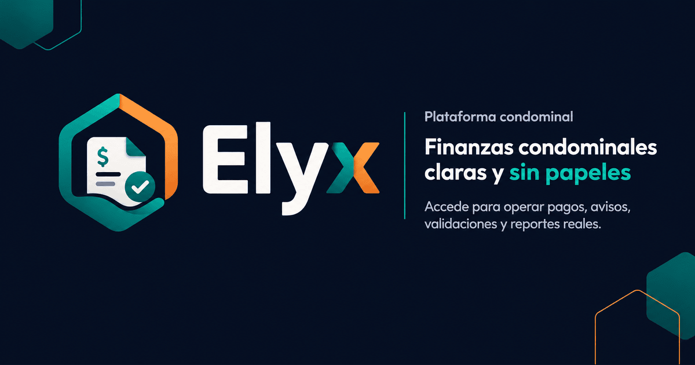
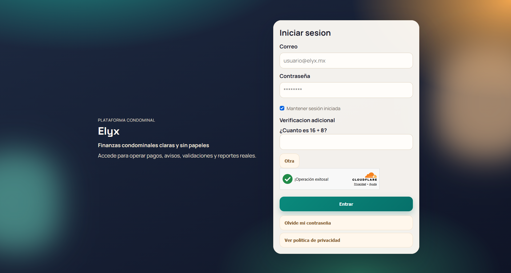
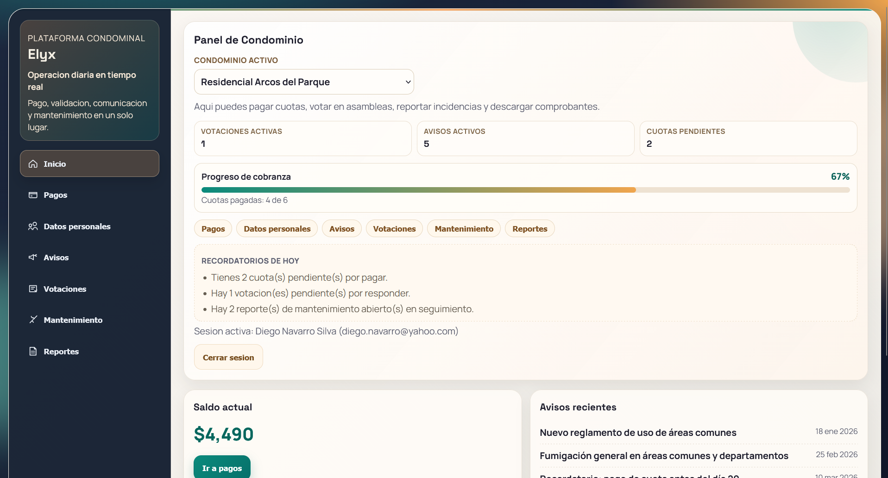
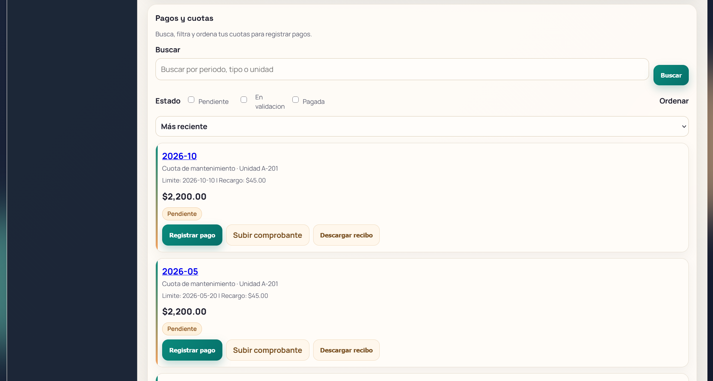
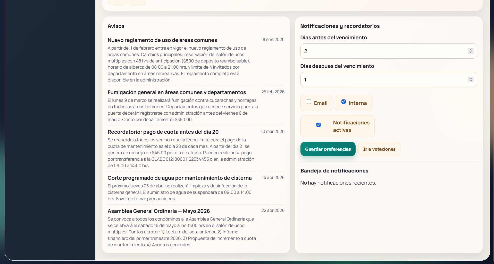
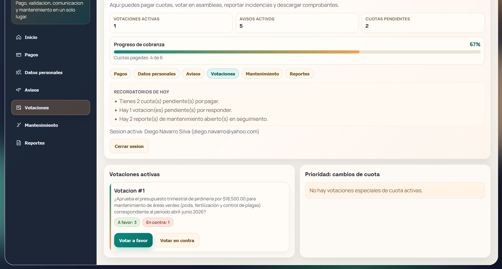
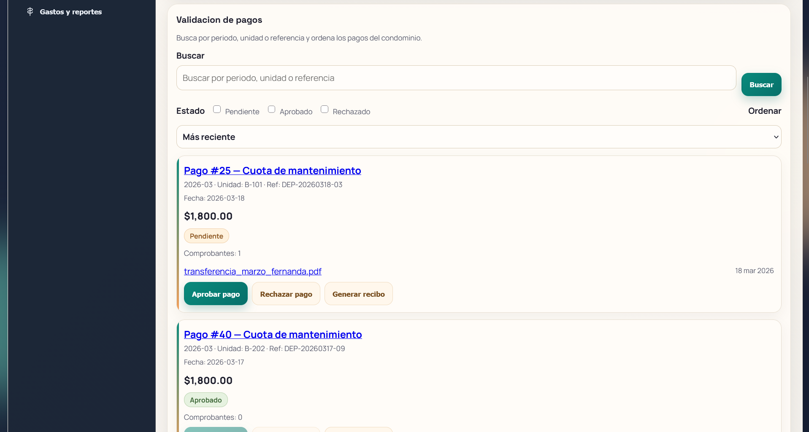
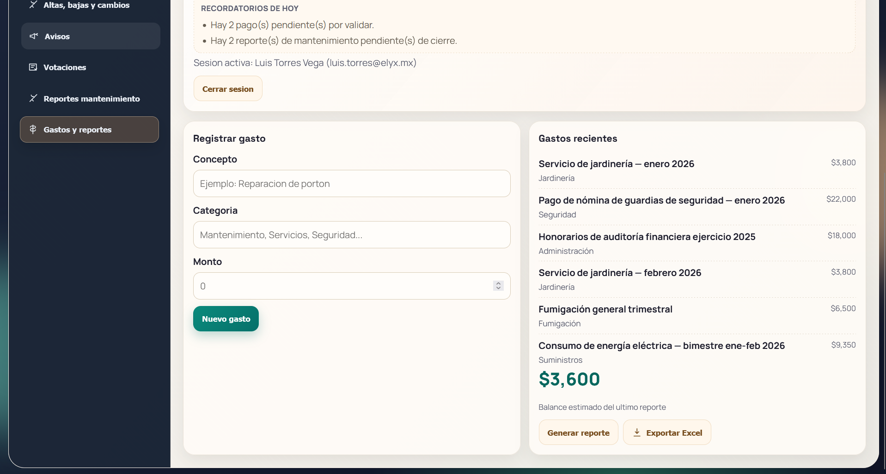
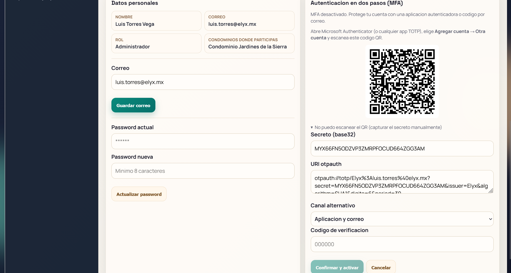

<div align="center">

# Elyx



**Administración de condominios sin papeles: cuotas, pagos, avisos, votaciones y finanzas en un solo lugar.**

[](https://react.dev)
[](https://nestjs.com)
[](https://www.postgresql.org)
[](https://www.typescriptlang.org)
[](https://docs.docker.com/compose/)

[Usar Elyx](#usar-elyx) · [Funcionalidades](#funcionalidades) · [Seguridad](#seguridad) · [Instalación](#instalación) · [API](#api)

</div>

---

## Contenido

- [Capturas](#capturas)
- [¿Qué es Elyx?](#qué-es-elyx)
- [Funcionalidades](#funcionalidades)
- [Seguridad](#seguridad)
- [Stack técnico](#stack-técnico)
- [Usar Elyx](#usar-elyx)
- [Instalación](#instalación)
- [Configuración](#configuración)
- [API](#api)
- [Estructura del repositorio](#estructura-del-repositorio)
- [Preguntas frecuentes](#preguntas-frecuentes)

---

## Capturas

| Inicio de sesión | Panel del condómino |
|:---:|:---:|
|  |  |

| Pagos y cuotas | Avisos |
|:---:|:---:|
|  |  |

| Votaciones | Validación de pagos (administrador) |
|:---:|:---:|
|  |  |

| Gastos y reportes financieros | Autenticación en dos pasos |
|:---:|:---:|
|  |  |

---

## ¿Qué es Elyx?

Elyx es una plataforma web para administrar un condominio de principio a fin. Sustituye
las hojas de cálculo, los grupos de mensajería y los recibos en papel por un sistema
donde cada parte ve exactamente lo que le corresponde:

- El **condómino** consulta su estado de cuenta, registra pagos, sube comprobantes,
  descarga recibos, responde votaciones y reporta fallas.
- El **administrador** valida pagos, emite cuotas, publica avisos, convoca votaciones
  —incluido el cambio de la cuota de mantenimiento— y lleva el control de gastos y
  reportes financieros.
- El **superusuario** atiende la plataforma completa: consulta todos los condominios, ajusta
  roles y confirma las suscripciones pendientes.

El alta es **de autoservicio**: cualquier administrador registra su condominio en
[elyx-app.com/crear-condominio](https://elyx-app.com/crear-condominio), confirma su correo,
paga la suscripción y obtiene un enlace para que sus condóminos se sumen solos. No hace falta
que nadie intervenga del lado de la plataforma.

Todo el dinero que se mueve en el condominio queda trazado: cada pago tiene su
comprobante, su validación, su recibo y su línea en el reporte financiero del periodo.

---

## Funcionalidades

### Para el condómino

| Módulo | Qué resuelve |
|---|---|
| **Estado de cuenta** | Saldo actual, adeudo total, recargos estimados y fecha de corte por unidad |
| **Pagos y cuotas** | Buscar, filtrar y ordenar sus cuotas; registrar pago, subir comprobante y descargar recibo |
| **Avisos** | Comunicados del administrador con fecha de publicación |
| **Votaciones** | Votar asambleas abiertas y consultar resultados |
| **Mantenimiento** | Reportar fallas con descripción y fotografías, y seguir el estatus |
| **Reportes** | Consultar el histórico de cuotas y pagos de su unidad |

### Para el administrador

| Módulo | Qué resuelve |
|---|---|
| **Validación de pagos** | Buscar por periodo, unidad o referencia; aprobar, rechazar (con motivo) y generar recibos |
| **Cuotas** | Emisión por periodo, monto, recargo por día y fecha límite por unidad |
| **Avisos** | Publicación de comunicados al condominio |
| **Votaciones** | Convocar votaciones generales y ejecutar acuerdos de cambio de cuota aprobados |
| **Reportes de mantenimiento** | Dar seguimiento a los reportes de los condóminos con comentarios y evidencias |
| **Gastos** | Registro de gastos por categoría, proveedor y comprobante |
| **Reportes financieros** | Ingresos, egresos y adeudos por periodo, con exportación a **PDF** y **Excel** |
| **Altas, bajas y cambios** | Administrar unidades, ocupantes y membresías del condominio |
| **Invitaciones** | Generar un enlace para que los condóminos se registren, con cupo igual a las unidades libres, y aprobar cada solicitud |
| **Suscripción** | Estado de la suscripción a Elyx, desglose de la cuota, pago con tarjeta o Link y datos fiscales (solo si esta instancia la cobra) |

### Para el superusuario

| Módulo | Qué resuelve |
|---|---|
| **Alta de condominios** | Crear el condominio, sus unidades y el primer administrador en un solo flujo; útil como respaldo del registro público |
| **Administración multi-condominio** | Consultar y operar los condominios de la plataforma |
| **Roles** | Ascender o degradar administradores; nunca deja un condominio sin ninguno |
| **Suscripciones** | Confirmar pagos, ver historial y activar, vencer o cancelar una suscripción |

### Transversal

- **Registro público ("Crea tu condominio")**: el camino normal de alta. El administrador
  registra su condominio, confirma su correo y paga; todo queda creado sin intervención
  manual. Se controla con `REGISTRO_PUBLICO_ENABLED`. El detalle paso a paso está en la
  sección **Usar Elyx**, más abajo.
- **Invitación por enlace**: el administrador comparte un link; cada condómino envía su
  solicitud, confirma su correo y el administrador la aprueba. El enlace se desactiva
  solo al agotarse las unidades libres.
- **Actualizaciones en tiempo real** por WebSocket: cuando cambia un pago o una cuota,
  la vista se refresca sin recargar la página.
- **Multi-condominio**: un usuario con membresías en varios condominios alterna entre
  ellos sin cerrar sesión.
- **Listados paginados** con búsqueda, filtro por estado y orden, con el estado en la
  URL para poder compartir o recuperar una vista exacta.
- **Diseño responsivo** para usarse desde escritorio, tableta o teléfono.

---

## Seguridad

Elyx se diseñó asumiendo que la sesión, el dinero y los datos personales son el activo a
proteger. Estas son las medidas implementadas, no intenciones:

| Medida | Implementación |
|---|---|
| **Access token corto** | JWT con `ACCESS_TOKEN_TTL=15m` |
| **Refresh token rotatorio** | Cookie `HttpOnly` + `SameSite=Strict`, acotada a `/api/auth`. Cada uso lo rota; el reuso de un token ya rotado revoca **toda la familia** |
| **"Mantener sesión iniciada"** | Opcional. Marcado: cookie persistente de 7 días. Sin marcar: cookie de sesión (sin `expires`) y token de 12 h; al cerrar el navegador hay que volver a entrar |
| **CSRF** | Doble envío: cookie `elyx_csrf` + cabecera `X-CSRF-Token`, validada por un guard global en todos los métodos mutantes |
| **Autorización por condominio** | Cada petición se contrasta contra las membresías del token; un condómino no puede leer otro condominio |
| **Segundo CAPTCHA propio** | Operación matemática de un solo uso, obligatoria tras 3 fallos de login y siempre en la recuperación de contraseña |
| **Turnstile** | Cloudflare Turnstile en el inicio de sesión, la recuperación de contraseña y el registro público (`TURNSTILE_ENABLED`) |
| **Verificación de correo** | Los enlaces de registro e invitación se guardan **solo como hash SHA-256** y caducan (24 h y 30 días). Un enlace filtrado no revela el token de otro |
| **Anti-abuso del registro** | 5 altas por cada 10 minutos por IP, bloqueo de dominios de correo desechables y respuesta genérica que no confirma si un correo ya tiene cuenta |
| **Anti-enumeración** | El registro responde igual exista o no la cuenta, y el correo de verificación se envía en ambos casos: la propiedad del buzón se prueba sin filtrar qué correos están dados de alta |
| **MFA** | TOTP compatible con Microsoft Authenticator o Google Authenticator (código QR + códigos de recuperación), con OTP de 6 dígitos por correo como alternativa |
| **Bloqueo progresivo** | Tras varios intentos fallidos la cuenta se bloquea de forma escalonada (5 → 15 → 30 → 60 minutos) |
| **Límite de peticiones** | `@nestjs/throttler` con almacenamiento en Redis |
| **Contraseñas** | Hash bcrypt; nunca se almacenan ni se registran en claro |
| **Secretos** | El secreto TOTP se guarda cifrado con AES-256-GCM (`MFA_ENCRYPTION_KEY`) |
| **Auditoría** | Cada intento de login (exitoso o no) y cada evento de comportamiento se registran en base de datos |
| **Telemetría de comportamiento** | Eventos agregados (sin valores de formulario) que puntúan la sesión; en modo `strict` se rechazan sesiones automatizadas |
| **Robots** | `robots.txt` declara privadas `/api/`, `/uploads/` y `/perfil`, con `Crawl-delay: 2` |

---

## Stack técnico

| Capa | Tecnología |
|---|---|
| **Frontend** | React 18, Vite 5, TypeScript 5, React Router 6, socket.io-client, pdf-lib, xlsx |
| **Backend** | NestJS 10, TypeScript 5, TypeORM (SQL explícito), `jsonwebtoken`, `bcrypt`, `qrcode`, `@nestjs/throttler` |
| **Base de datos** | PostgreSQL 16 |
| **Caché y colas ligeras** | Redis 7 (throttler, retos de CAPTCHA/MFA, bloqueo de cuentas) |
| **Correo** | SMTP o Resend (`RESEND_API_KEY`) |
| **Orquestación** | Docker Compose |

---

## Usar Elyx

Hay dos caminos. Ambos usan exactamente el mismo código.

### A) Usar Elyx alojado — [elyx-app.com](https://elyx-app.com)

La instancia oficial es **de autoservicio**: registras tu condominio en la web, pagas la
suscripción y quedas operando el mismo día. Si prefieres que lo hagamos nosotros, hay un
camino alternativo al final de esta sección.

#### 1. Registra tu condominio

Entra a **[elyx-app.com/crear-condominio](https://elyx-app.com/crear-condominio)** y completa
el asistente de tres pasos. No hace falta instalar nada ni hablar con nadie.

| Paso | Qué se pide | Por qué |
|---|---|---|
| **1. Condominio** | Nombre, dirección, número de unidades, prefijo de las unidades (`Depto `, `Casa `, `Local `) y tipo | Con eso se generan las fichas de todas las unidades y se calcula la cuota |
| **2. Unidades y cuota** | Monto de la cuota, día límite de pago y recargo por día de atraso | Se usa para emitir el primer periodo en cuanto confirmes tu correo |
| **3. Tu cuenta** | Nombre, apellidos, correo, teléfono y contraseña | Serás el primer administrador del condominio |

Al terminar, Elyx te envía un **correo de verificación con un enlace válido 24 horas**. El
condominio aún **no existe**: se crea justo cuando abres ese enlace. Ese paso prueba que el
buzón es tuyo, así nadie puede registrar un condominio a nombre de un correo ajeno.

> **Cómo se nombran las unidades:** el prefijo se respeta tal cual, incluido el espacio final.
> Con `Depto ` y 20 unidades obtienes `Depto 1` … `Depto 20`. El nombre de las unidades se
> puede cambiar después, pero conviene definirlo bien desde el inicio.

**Al confirmar el correo, en una sola transacción se crea:**

- el condominio, en estado `PENDIENTE_PAGO` (o `ACTIVO` si la instancia no cobra suscripción);
- todas las unidades con su clave;
- tu usuario administrador y tu membresía;
- la cuota del primer periodo para cada unidad;
- la suscripción pendiente, con su referencia de pago.

Después entras con el correo y la contraseña que elegiste, y el panel te muestra el estado de
tu suscripción con el desglose de la cuota.

#### 2. Paga la suscripción y activa el condominio

Con la suscripción activa en la instancia, el condominio nace **pendiente de pago**: puedes
entrar y ver el panel, pero no puedes generar invitaciones ni dar de alta condóminos hasta
regularizarlo. La operación diaria no se bloquea, porque el impago es del administrador y no
de los condóminos. El cobro se hace **dentro de la plataforma**, sin salir a otra pestaña:

1. Captura tus **datos fiscales** (RFC, razón social, régimen fiscal y código postal). Se
   piden antes del primer pago porque migrarlos después, con clientes activos, cuesta mucho más.
2. Pulsa **Continuar al pago**. Elyx muestra el desglose completo: cuota base, costo por unidad,
   ajuste a la cuota mínima si aplica, subtotal, IVA y total.
3. Paga con **tarjeta de débito, crédito o American Express**, o con
   [Stripe Link](https://stripe.com/mx/payments/link) si ya guardaste tus datos.
4. El pago lo confirma Stripe; el condominio pasa a **activo** en segundos y queda registrado
   el comprobante con su periodo.

> Si el pago no se confirma al instante (por ejemplo, porque el webhook no llegó), una
> **reconciliación diaria** consulta el estado real en Stripe y corrige la suscripción. No
> tienes que escribirnos para que se active.

#### 3. Suma a tus condóminos con un enlace

En **Invitaciones**, el administrador genera un enlace y lo comparte por WhatsApp, correo o
donde prefiera. Cada condómino:

1. abre el enlace y ve el nombre del condominio y **cuántas unidades libres quedan**;
2. elige su unidad, escribe sus datos, define su contraseña y confirma su correo;
3. espera la aprobación del administrador.

El administrador revisa la solicitud y la **aprueba o rechaza**. Al aprobarla, el condómino
entra con la contraseña que eligió y ya tiene su estado de cuenta con la cuota del periodo.

Detalles que conviene saber:

- El **cupo del enlace es igual al número de unidades libres**. Al reclamar la última, el enlace
  se desactiva solo y avisa al administrador.
- Solo hay **un enlace activo a la vez**: si lo regeneras, el anterior queda revocado.
- Si el correo ya tiene cuenta en Elyx, no se le crea otra: se le suma el condominio a la
  misma cuenta.
- El enlace caduca a los `INVITACION_EXPIRACION_DIAS` días (30 por defecto).

#### 4. Alternativa: nosotros lo hacemos por ti

Si no quieres pasar por el asistente, escríbenos con el nombre de tu condominio, su dirección
y el número de unidades. Te lo dejamos creado y te enviamos las credenciales.

**Contacto:** [contacto@elyx-app.com](mailto:contacto@elyx-app.com)

#### 5. Costo

**Tarifa mensual** (pesos mexicanos, MXN): cuota base más costo por unidad, con piso mensual.
El IVA se muestra aparte porque se entera al SAT: **no es ingreso de Elyx**.

| Unidades | Cuota mensual (antes de IVA) | IVA 16% | Total a pagar |
|---:|---:|---:|---:|
| 10 | $270.00 | $43.20 | **$313.20** |
| 30 | $410.00 | $65.60 | **$475.60** |
| 40 | $480.00 | $76.80 | **$556.80** |
| 50 | $550.00 | $88.00 | **$638.00** |

La fórmula es **$200 de cuota base + $7 por unidad**, con un piso de **$250** al mes (para que
un condominio pequeño no pague menos que eso). Con 60 unidades serían $620 + IVA = $719.20.

Desde el panel se ve el estado de la suscripción, el desglose de la cuota y el total pagado;
las facturas y el cambio de tarjeta se gestionan en el portal de cliente de Stripe. Puedes
cancelar cuando quieras y el condominio sigue operando hasta el final del periodo pagado.

<!--
  TODO: sustituye contacto@elyx-app.com por tu correo real y, si quieres,
  añade aquí tu teléfono o un enlace de WhatsApp.
-->

> ¿Prefieres verlo antes de decidir? Entra a **https://elyx-app.com/crear-condominio** y
> regístrate: verás el asistente completo y el panel con tu condominio real. Si prefieres que
> te preparemos una demostración con datos de ejemplo, escríbenos a
> contacto@elyx-app.com.

### B) Autoalojarlo tú

Elyx es autocontenido: un `docker compose up` levanta base de datos, caché, API y
aplicación web. Si tienes un servidor con Docker, en unos minutos tienes tu propia
instancia.

- **En tu computadora:** http://localhost:5173
- **En tu servidor:** el dominio que apuntes (por ejemplo, `https://elyx.midominio.com`)

Sigue la sección de [Instalación](#instalación).

---

## Instalación

### Requisitos

- Docker Engine 24+ con el plugin `docker compose` (v2)
- 2 GB de RAM y 5 GB de disco libres como mínimo

### Local

```bash
# 1. Variables de entorno
cp .env.example .env

# 2. Levantar el stack (la primera vez compila las imágenes)
docker compose up --build
```

Servicios:

| Servicio | URL |
|---|---|
| Aplicación web | http://localhost:5173 |
| API | http://localhost:3000/api |
| Estado del backend | http://localhost:3000/api/health |

La base de datos se inicializa sola con el esquema y datos de ejemplo la primera vez que
arranca el volumen (`infra/postgres/init`).

### Actualizar una instancia existente

```bash
git fetch --all
git pull --ff-only

docker compose up -d --force-recreate --build backend frontend
```

Si el `pull` trajo cambios en el esquema, aplica la migración correspondiente de
`apps/backend/src/database/migrations/` antes de reiniciar.

### Producción

En producción la aplicación web **no** se sirve con el servidor de desarrollo de Vite:
se compila y se sirve como archivos estáticos con nginx. El archivo
`docker-compose-prod.yml` trae esa configuración (imagen `Dockerfile.prod`, sin bind
mounts del frontend y con el puerto del host apuntando al `80` del contenedor).

1. Copia tu configuración de producción en `.env` y ajusta como mínimo:

   ```env
   NODE_ENV=production
   COOKIE_SECURE=true
   AUTH_REQUIRED=true
   FRONTEND_URL=https://tu-dominio.com
   VITE_API_URL=https://api.tu-dominio.com
   PUBLIC_FILES_BASE_URL=https://api.tu-dominio.com
   CORS_ALLOWED_ORIGINS=https://tu-dominio.com,https://www.tu-dominio.com
   VITE_TURNSTILE_SITE_KEY=<sitekey pública de Turnstile>
   JWT_SECRET=<cadena aleatoria larga>
   CSRF_SECRET=<cadena aleatoria larga>
   MFA_ENCRYPTION_KEY=<cadena aleatoria larga>
   ```

2. Levanta el stack con el archivo de producción:

   ```bash
   docker compose -f docker-compose-prod.yml up -d --build
   ```

3. Publica la API y la web detrás de un proxy inverso con TLS (nginx, Caddy, Traefik) y
   no expongas los puertos de los contenedores a internet.
4. Programa respaldos del volumen de PostgreSQL (`postgres_data`) y del directorio de
   archivos subidos (`apps/backend/uploads`).

**Al actualizar en producción:**

```bash
git fetch --all && git pull --ff-only

# Solo lo que cambió. Si tocaste el frontend, se recompila el bundle.
docker compose -f docker-compose-prod.yml up -d --build frontend
```

> `VITE_API_URL` y `VITE_TURNSTILE_SITE_KEY` se **hornean en el bundle** al compilar. Si
> cambias alguna, hay que reconstruir la imagen del frontend (`--build`); reiniciar el
> contenedor no basta.

> Con `COOKIE_SECURE=true` el navegador exige HTTPS: sin TLS el inicio de sesión no
> funcionará. Es intencional.

**Por qué no se usa Vite en producción:** el servidor de desarrollo transforma archivos
bajo demanda y con un bind mount deja accesible todo el árbol del proyecto por HTTP
(`Dockerfile`, `.dockerignore`, `tsconfig.json`…). Al pedir uno de esos archivos, Vite
intenta parsearlo como JavaScript y responde con
`Failed to parse source for import analysis`. Compilar y servir con nginx elimina el
problema de raíz, además de reducir memoria y no exponer source maps.

---

## Configuración

Todas las variables viven en `.env`. Las más relevantes:

### Base de datos y red

| Variable | Por defecto | Para qué |
|---|---|---|
| `POSTGRES_DB` / `POSTGRES_USER` / `POSTGRES_PASSWORD` | `elyx` / `elyx_user` / `elyx_pass` | Credenciales de PostgreSQL |
| `DATABASE_URL` | `postgres://…@postgres:5432/elyx` | Cadena de conexión |
| `REDIS_URL` | `redis://redis:6379` | Caché y límites |
| `BACKEND_PORT` / `FRONTEND_PORT` | `3000` / `5173` | Puertos publicados |
| `FRONTEND_URL` | `http://localhost:5173` | Origen permitido y enlaces en correos |
| `CORS_ALLOWED_ORIGINS` | vacío | Lista separada por comas; se añade sola la variante con/sin `www.` |
| `PUBLIC_FILES_BASE_URL` | `http://localhost:3000` | Base para las URLs de comprobantes y evidencias |

### Sesiones y seguridad

| Variable | Por defecto | Para qué |
|---|---|---|
| `AUTH_REQUIRED` | `true` | Exige token Bearer en los endpoints protegidos |
| `ACCESS_TOKEN_TTL` | `15m` | Vida del access token |
| `REFRESH_TOKEN_TTL_DAYS` | `7` | Vida del refresh cuando se marca "mantener sesión iniciada" |
| `REFRESH_TOKEN_TTL_SESSION_HOURS` | `12` | Vida del refresh cuando **no** se marca |
| `COOKIE_SECURE` | `false` | `true` en producción (requiere HTTPS) |
| `JWT_SECRET` | — | Firma de los JWT |
| `CSRF_SECRET` | — | Firma de los tokens CSRF |
| `MFA_ENCRYPTION_KEY` | — | Cifrado AES-256-GCM del secreto TOTP |
| `CAPTCHA_MATH_ENABLED` | `true` | Activa el segundo CAPTCHA propio |
| `CAPTCHA_MATH_ENFORCE` | `after_failures` | `always` para exigirlo siempre |
| `BEHAVIOR_ENFORCE` | `soft` | `soft` solo mide; `strict` rechaza sesiones automatizadas |
| `TURNSTILE_ENABLED` / `TURNSTILE_SECRET_KEY` | `false` / — | Cloudflare Turnstile |

### Correo

| Variable | Para qué |
|---|---|
| `SMTP_HOST`, `SMTP_PORT`, `SMTP_USER`, `SMTP_PASS`, `SMTP_FROM` | Envío por SMTP (recuperación de contraseña, OTP) |
| `RESEND_API_KEY` | Alternativa a SMTP vía Resend |

### Registro público e invitaciones

| Variable | Por defecto | Para qué |
|---|---|---|
| `REGISTRO_PUBLICO_ENABLED` | `true` | `false` oculta "Crea tu condominio": solo el superusuario crea condominios |
| `REGISTRO_EXPIRACION_HORAS` | `24` | Vigencia del enlace de verificación de correo |
| `INVITACION_EXPIRACION_DIAS` | `30` | Vigencia del enlace de invitación de condóminos |
| `PUBLIC_APP_URL` | `http://localhost:5173` | Base de los enlaces enviados por correo |

### Suscripción a Elyx (opcional)

Al ser un proyecto open source, el cobro de suscripción está **desactivado por defecto**.
Con `SUSCRIPCION_ENABLED=false` el producto funciona completo y sin límites comerciales.

| Variable | Por defecto | Para qué |
|---|---|---|
| `SUSCRIPCION_ENABLED` | `false` | `true` exige suscripción activa para invitar y dar de alta |
| `SUSCRIPCION_PROVIDER` | `MANUAL` | `MANUAL` (transferencia), `STRIPE` (checkout) o `NULL` |
| `SUSCRIPCION_PRECIO_BASE` | `200` | Cuota base mensual **neta** (MXN) |
| `SUSCRIPCION_PRECIO_UNIDAD` | `7` | Costo mensual **neto** por unidad contratada |
| `SUSCRIPCION_PRECIO_PISO` | `250` | Piso mensual **neto**: evita precios irrisorios en condominios pequeños |
| `SUSCRIPCION_IVA_PORCENTAJE` | `16` | IVA que se **desglosa** sobre el neto (no es ingreso de Elyx) |
| `SUSCRIPCION_DIAS_GRACIA` | `7` | Días antes de suspender tras un cobro fallido. Suspender bloquea altas e invitaciones, no la operación diaria |
| `SUSCRIPCION_DIAS_PRUEBA` | `0` | `0` = pago inmediato, sin periodo de prueba |
| `SUSCRIPCION_DATOS_PAGO` | vacío | Instrucciones de transferencia (solo con `MANUAL`) |
| `SUSCRIPCION_PURGA_DIAS` | `30` | Días antes de borrar un condominio que nunca pagó |

**Precio:** `max(piso, base + (unidades × costo por unidad))`, todo **neto**. El IVA se suma
después y se muestra desglosado.

| Unidades | Neto | IVA 16% | Total cobrado |
|---|---|---|---|
| 10 | $270 | $43.20 | $313.20 |
| 30 | $410 | $65.60 | $475.60 |
| 40 | $480 | $76.80 | $556.80 |
| 50 | $550 | $88.00 | $638.00 |

> La prueba del producto es la **demo con datos de ejemplo** (`02_seed.sql`), no un periodo
> de prueba.

#### Cobro con Stripe (opcional)

Con `SUSCRIPCION_PROVIDER=STRIPE` el administrador paga con un checkout **embebido** dentro de
Elyx. [Stripe Link](https://stripe.com/mx/payments/link) aparece automáticamente como método de
pago: es una **cartera**, no una pasarela aparte, y se activa en el Dashboard
(`Settings → Payment methods`), sin código.

| Variable | Para qué |
|---|---|
| `STRIPE_SECRET_KEY` | Clave secreta (`sk_test_…` en pruebas, `sk_live_…` en producción) |
| `STRIPE_WEBHOOK_SECRET` | Secreto del endpoint de webhooks (`whsec_…`). Sin él los webhooks se rechazan |
| `STRIPE_PRICE_BASE` / `STRIPE_PRICE_UNIDAD` | Price IDs recurrentes (`price_…`). Opcionales: sin ellos se usa `price_data` dinámico |
| `STRIPE_TAX_RATE_ID` | Tax Rate del IVA (`txr_…`). Si falta, se crea/reutiliza uno al vuelo |
| `VITE_STRIPE_PUBLISHABLE_KEY` | Clave publicable (`pk_test_…`) que usa el frontend |

**Webhook:** apunta Stripe a `https://tu-dominio/api/webhooks/stripe`. En local:

```bash
stripe listen --forward-to localhost:3000/api/webhooks/stripe
```

La CLI imprime el `whsec_…` que debes poner en `STRIPE_WEBHOOK_SECRET`.

> **Nota sobre Link:** es un método con tarjeta. SPEI y OXXO no sirven para cobros
> recurrentes, por eso el proveedor `MANUAL` sigue disponible como alternativa.

> **Facturación (CFDI):** fuera del alcance actual. Elyx captura RFC, razón social, régimen
> fiscal y CP antes del checkout para poder emitir facturas más adelante sin migrar datos.

> Sin correo configurado, los mensajes se escriben en el log del backend: útil en
> desarrollo, insuficiente en producción.

---

## API

API REST bajo `/api`. Todos los endpoints de negocio exigen `Authorization: Bearer <token>`
y validan la pertenencia al condominio solicitado.

### Autenticación

| Método | Ruta | Descripción |
|---|---|---|
| `GET` | `/api/auth/csrf` | Devuelve el token CSRF vigente (solo emite uno nuevo si la cookie falta o no es válida) |
| `POST` | `/api/auth/login` | Inicia sesión; responde `202` si hace falta segundo factor |
| `POST` | `/api/auth/refresh` | Rota el refresh token y entrega un access token nuevo |
| `POST` | `/api/auth/logout` | Revoca la sesión persistente |
| `POST` | `/api/auth/forgot-password` | Solicita el restablecimiento de contraseña |
| `POST` | `/api/auth/validate-reset-token` | Comprueba que el enlace de restablecimiento sigue vigente |
| `POST` | `/api/auth/reset-password` | Define la nueva contraseña con el token recibido |
| `PATCH` | `/api/auth/perfil` | Actualiza los datos personales |
| `PATCH` | `/api/auth/password` | Cambio de contraseña estando autenticado |
| `GET` | `/api/captcha/challenge` | Reto matemático de un solo uso |

### Segundo factor (MFA)

| Método | Ruta | Descripción |
|---|---|---|
| `POST` | `/api/auth/mfa/setup` | Genera el secreto TOTP y el código QR |
| `POST` | `/api/auth/mfa/enable` | Activa MFA verificando el primer código |
| `POST` | `/api/auth/mfa/verify` | Verifica el código del desafío de login |
| `POST` | `/api/auth/mfa/resend` | Reenvía el OTP por correo |
| `GET` | `/api/auth/mfa/estado` | Estado de MFA del usuario |
| `POST` | `/api/auth/mfa/disable` | Desactiva MFA |

### Cuotas y pagos

| Método | Ruta | Descripción |
|---|---|---|
| `GET` | `/api/cuotas` | Cuotas del condominio |
| `GET` | `/api/cuotas/condomino` | Cuotas de un condómino |
| `GET` | `/api/cuotas/paginado` | Cuotas con `page`, `pageSize`, `q`, `estado`, `orden` e `idUsuarioCondominio` |
| `GET` | `/api/pagos` | Pagos del condominio |
| `GET` | `/api/pagos/paginado` | Pagos con `page`, `pageSize`, `q`, `estado`, `orden` e `idUsuarioCondominio` |
| `PATCH` | `/api/pagos/capturar` | Registra un pago |
| `PATCH` | `/api/pagos/aprobar` | El administrador valida el pago |
| `PATCH` | `/api/pagos/rechazar` | El administrador rechaza el pago (con motivo) |
| `GET` | `/api/evidencias-pago` | Comprobantes cargados |
| `GET` | `/api/recibos` | Recibos emitidos |
| `POST` | `/api/recibos/generar` | Genera el recibo de un pago validado |

### Comunicación y comunidad

| Método | Ruta | Descripción |
|---|---|---|
| `GET` | `/api/avisos` | Avisos del condominio |
| `GET` | `/api/votaciones` | Votaciones |
| `POST` | `/api/votaciones/votar` | Emite un voto |
| `POST` | `/api/votaciones/cambio-cuota` | Propone un cambio de cuota |
| `PATCH` | `/api/votaciones/cerrar` | Cierra una votación |
| `GET` | `/api/votaciones/cambios-cuota` | Propuestas de cambio de cuota |
| `PATCH` | `/api/votaciones/cambio-cuota/ejecutar` | Aplica un cambio de cuota aprobado |
| `GET` | `/api/notificaciones` | Notificaciones del usuario |
| `POST` | `/api/notificaciones/programar` | Programa una notificación |
| `PATCH` | `/api/notificaciones/leer` | Marca como leída |
| `GET` | `/api/config-notificaciones` | Preferencias de aviso |
| `POST` | `/api/config-notificaciones/guardar` | Guarda las preferencias |

### Mantenimiento y finanzas

| Método | Ruta | Descripción |
|---|---|---|
| `GET` | `/api/reportes-mantenimiento` | Reportes de fallas |
| `PATCH` | `/api/reportes-mantenimiento/estado` | Cambia el estatus de un reporte |
| `GET` | `/api/fotos-mantenimiento` | Fotografías adjuntas a los reportes |
| `GET` | `/api/gastos` | Gastos del condominio por periodo y categoría |
| `GET` | `/api/reportes-financieros` | Reportes financieros (ingresos, egresos y adeudos) |

### Unidades, condóminos y plataforma

| Método | Ruta | Descripción |
|---|---|---|
| `GET` | `/api/unidades/usuario-condominio/:id` | Unidad y ocupante de una membresía |
| `GET` | `/api/condominos/unidades` | Unidades del condominio |
| `GET` | `/api/condominos/unidades-disponibles` | Unidades sin ocupante vigente |
| `POST` | `/api/condominos/altas` | Alta de condómino |
| `GET` | `/api/condominos/solicitudes-cambio` | Solicitudes de cambio |
| `POST` | `/api/condominos/solicitudes-cambio` | Crea una solicitud |
| `PATCH` | `/api/condominos/solicitudes-cambio/aprobar` | Aprueba una solicitud |
| `PATCH` | `/api/condominos/solicitudes-cambio/rechazar` | Rechaza una solicitud |
| `PATCH` | `/api/condominos/solicitudes-cambio/ejecutar` | Aplica una solicitud aprobada |
| `POST` | `/api/usuarios/onboarding-inicial` | Alta de condominio, unidades y primer administrador |
| `GET` | `/api/usuarios/super/condominios` | Condominios de la plataforma (superusuario) |
| `GET` | `/api/usuarios/super/condominios/:id/miembros` | Membresías con rol y unidades ocupadas |
| `PATCH` | `/api/usuarios/super/condominios/:id/miembros/:idMembresia/rol` | Asciende o degrada a un administrador |
| `PATCH` | `/api/usuarios/super/condominios/:id/estado` | Activa o suspende un condominio |

### Registro público e invitaciones

| Método | Ruta | Descripción |
|---|---|---|
| `GET` | `/api/registro/disponible` | Indica si esta instancia acepta altas públicas |
| `POST` | `/api/registro/condominio` | Solicita el alta de un condominio (envía verificación por correo) |
| `GET` | `/api/registro/verificar?token=` | Confirma el correo y crea el condominio, unidades y cuota inicial |
| `POST` | `/api/registro/reenviar-verificacion` | Reenvía el enlace de verificación |
| `GET` | `/api/invitaciones` | Estado del enlace y cupo (administrador) |
| `POST` | `/api/invitaciones` | Genera o regenera el enlace de invitación |
| `PATCH` | `/api/invitaciones/revocar` | Desactiva el enlace vigente |
| `GET` | `/api/invitaciones/solicitudes` | Solicitudes de alta recibidas |
| `PATCH` | `/api/invitaciones/solicitudes/aprobar` | Aprueba una solicitud verificada |
| `PATCH` | `/api/invitaciones/solicitudes/rechazar` | Rechaza una solicitud |
| `GET` | `/api/invitaciones/publica/:token` | Datos públicos del enlace y unidades libres |
| `POST` | `/api/invitaciones/publica/:token/solicitud` | Envía una solicitud de alta |
| `POST` | `/api/invitaciones/publica/confirmar` | Confirma el correo de la solicitud |

### Suscripción (opcional)

| Método | Ruta | Descripción |
|---|---|---|
| `GET` | `/api/suscripciones/mia` | Estado de la suscripción del condominio (administrador) |
| `POST` | `/api/suscripciones/mia/cobro` | Genera el cobro: `clientSecret` (embebido) o referencia (manual) |
| `POST` | `/api/suscripciones/mia/portal` | Abre el portal de cliente de Stripe (tarjeta, facturas, cancelar) |
| `GET` | `/api/suscripciones/mia/datos-fiscales` | RFC, razón social, régimen fiscal y CP capturados |
| `PATCH` | `/api/suscripciones/mia/datos-fiscales` | Captura los datos fiscales para el futuro CFDI |
| `PATCH` | `/api/suscripciones/mia/unidades` | Ajusta la cantidad facturada en Stripe con prorrateo |
| `GET` | `/api/suscripciones` | Todas las suscripciones (superusuario) |
| `GET` | `/api/suscripciones/:id/pagos` | Historial de pagos de la suscripción |
| `PATCH` | `/api/suscripciones/:id/confirmar-pago` | Confirma manualmente un pago (solo proveedor `MANUAL`) |
| `PATCH` | `/api/suscripciones/:id/estado` | Activa, vence o cancela la suscripción |
| `POST` | `/api/webhooks/stripe` | Webhook de Stripe (público, autenticado por firma) |
| `POST` | `/api/behavior` | Telemetría de comportamiento (público, con límite de peticiones) |
| `GET` | `/api/health` | Estado del servicio |

### Ejemplo

```bash
# Login: el token CSRF viaja en la cookie y se copia a la cabecera
curl -i -X POST https://api.tu-dominio.com/api/auth/login \
  -H "Content-Type: application/json" \
  -H "X-CSRF-Token: <token>" \
  -d '{"correo":"admin@condominio.mx","password":"<contraseña>","recordarme":true}'
```

### Rutas de la aplicación

**Públicas** (no requieren sesión):

| Ruta | Vista |
|---|---|
| `/crear-condominio` | Asistente de registro de un condominio nuevo |
| `/crear-condominio/verificar` | Confirmación del correo: aquí se crea el condominio |
| `/invitacion/:token` | Alta de un condómino mediante el enlace del administrador |
| `/invitacion/confirmar` | Confirmación del correo de la solicitud |

**Privadas** (requieren sesión):

| Ruta | Vista |
|---|---|
| `/inicio` | Panel (condómino o administrador, según el rol) |
| `/pagos` | Pagos y cuotas del condómino |
| `/validaciones` | Validación de pagos (administrador) |
| `/avisos` | Avisos |
| `/votaciones` | Votaciones |
| `/mantenimiento` | Reportes de mantenimiento |
| `/reportes` | Reportes del condómino |
| `/finanzas` | Gastos y reportes financieros |
| `/solicitudes` | Altas, bajas y cambios |
| `/invitaciones` | Enlace de invitación y solicitudes pendientes (administrador) |
| `/suscripcion` | Estado de la suscripción y datos fiscales (administrador) |
| `/nuevo-condominio` | Alta de otro condominio desde una sesión ya iniciada |
| `/perfil` | Datos personales, contraseña y MFA |

### Tiempo real

El frontend se suscribe por Socket.IO a un espacio de nombres por dominio, de modo que un
cambio se refleja en todas las sesiones abiertas sin recargar:

`/ws/pagos` · `/ws/evidencias` · `/ws/mantenimientos` · `/ws/avisos` · `/ws/votaciones` · `/ws/notificaciones`

---

## Estructura del repositorio

```text
Elyx/
├── apps/
│   ├── backend/            # API NestJS
│   │   ├── src/
│   │   │   ├── common/     # auth, CSRF, guards, utilidades, MFA (TOTP)
│   │   │   ├── database/   # migraciones SQL
│   │   │   └── modules/    # auth, cuotas, pagos, avisos, votaciones, gastos, …
│   │   │       ├── condominio-alta/   # alta compartida (registro, onboarding, invitaciones)
│   │   │       ├── cupo/              # cupo de unidades y operatividad del condominio
│   │   │       ├── registro/          # "Crea tu condominio" + verificación de correo
│   │   │       ├── invitaciones/      # enlace, solicitudes y aprobación
│   │   │       ├── suscripciones/     # cobro de la plataforma (MANUAL | STRIPE)
│   │   │       └── membresias/        # cambio de rol con guard de último administrador
│   │   └── uploads/        # comprobantes y evidencias (volumen persistente)
│   └── frontend/           # SPA React + Vite
│       ├── public/         # robots.txt, imágenes
│       └── src/
│           ├── components/ # lista paginada, CAPTCHA, MFA, checkout, paneles
│           ├── pages/      # Login, Dashboard, Superusuario
│           │   └── public/ # crear condominio, verificación, invitación
│           ├── services/   # cliente de la API y telemetría
│           └── types/
├── docs/
│   ├── capturas/           # capturas usadas en este README
│   ├── estructura-proyecto.md
│   └── politica-privacidad.md
├── infra/postgres/init/    # esquema y datos de ejemplo
├── scripts/                # datos de prueba
├── docker-compose.yml
├── docker-compose-prod.yml
└── .env.example
```

---

## Preguntas frecuentes

**¿Cómo doy de alta mi condominio?**
Entra a [elyx-app.com/crear-condominio](https://elyx-app.com/crear-condominio), completa el
asistente de tres pasos y confirma el correo que te llega. El condominio, sus unidades, tu
cuenta de administrador y la primera cuota se crean en ese momento. Después pagas la
suscripción y generas el enlace para tus condóminos.

**¿Necesito instalar algo en las computadoras de los condóminos?**
No. Elyx funciona en el navegador, en escritorio y en móvil.

**¿Puedo tener varios condominios en la misma instancia?**
Sí. La plataforma es multi-condominio: un administrador con membresías en varios
condominios alterna entre ellos sin cerrar sesión.

**¿Qué pasa si olvido mi contraseña?**
Se restablece desde "Olvidé mi contraseña" con verificación adicional. Si además tienes
MFA activo, se te pedirá el segundo factor al entrar.

**¿Dónde quedan los comprobantes que suben los condóminos?**
En el volumen de archivos del backend, y sólo son accesibles para el condómino dueño del
pago, el administrador de su condominio y el superusuario.

**¿Elyx cobra comisión por los pagos de los condóminos?**
No. Elyx no intermedia el dinero de las cuotas: registra el pago, valida el comprobante y
emite el recibo, pero el dinero va del condómino al condominio por el medio que ellos
acuerden (transferencia, depósito, efectivo). Hoy **no** se paga la cuota de mantenimiento
con tarjeta desde la plataforma.

Lo que sí se cobra es la **suscripción a Elyx**: un cargo mensual distinto, a nombre del
condominio, que se paga con tarjeta o Link desde el panel de administración.

**¿Puedo exportar la información?**
Sí. Los reportes financieros se exportan a PDF y Excel, y la base de datos es PostgreSQL
estándar.

---

<div align="center">

Hecho para que administrar un condominio deje de ser un trabajo de fin de mes.

**¿Quieres usar Elyx en tu condominio?** [contacto@elyx-app.com](mailto:contacto@elyx-app.com) · [elyx-app.com](https://elyx-app.com)

</div>
